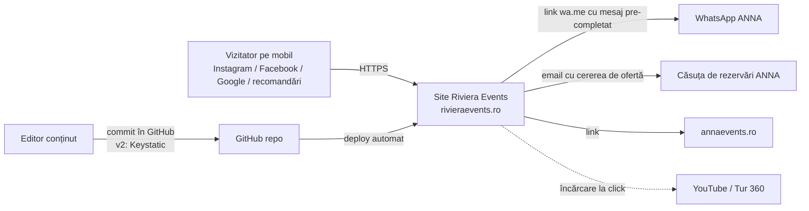
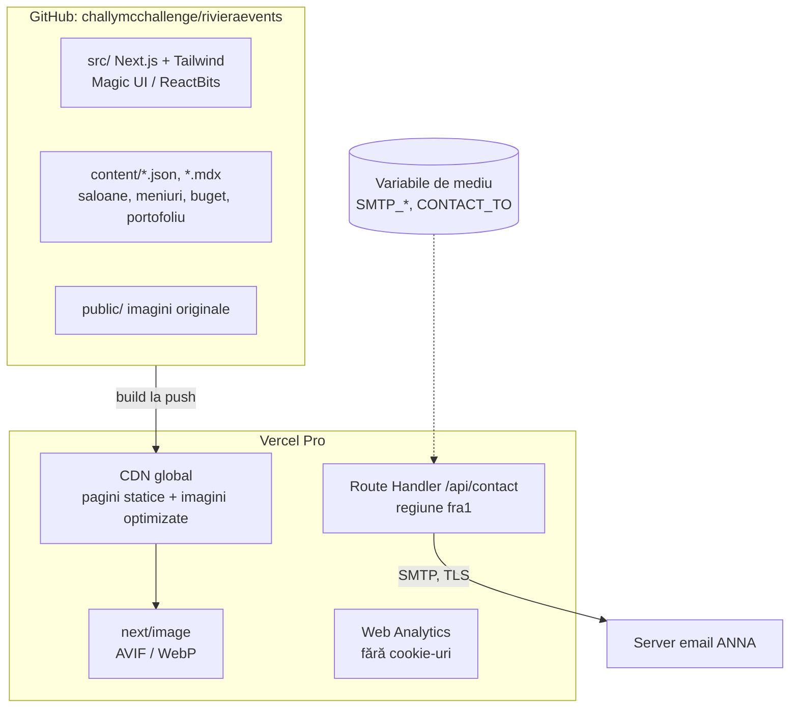
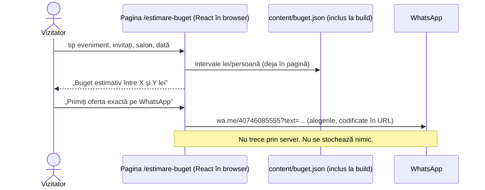

# Arhitectură: site Riviera Events by ANNA

**Versiune:** 1.0 (Faza 2), 2026-10-28
**Status:** propunere, **decizia finală aparține clientului** (GATE 2)
**Metodă:** skill SOFI, mod Greenfield. Cerințele vin din [docs/brief.md](../brief.md), aprobat la GATE 1.
**Convenții:** `[PRESUPUNERE]` = nu a fost spus de client și nu a fost verificat. Prețurile au sursa și data verificării. „Estimare” = calculată din presupuneri, cu calculul arătat.

---

## 1. Cerințe

### 1.1 Funcționale (din brief, §7)

1. **Pagini de prezentare:** Acasă, 7 saloane (Riviera primele), Pachete, Meniuri, Portofoliu, Despre, Contact și paginile legale.
2. **Bară fixă pe mobil:** WhatsApp, Sună, Estimare.
3. **WhatsApp pre-completat** pe pagina de salon și din calculator.
4. **Calculator de buget** cu interval. Datele stau într-un fișier editabil. Rulează în browser, fără backend.
5. **Formular de contact:** endpoint configurabil prin variabilă de mediu, validare, mesaj de confirmare. Fără stocarea datelor personale.
6. **Galerii** foto pe salon și pe evenimentul din portofoliu. **Tur 360** încorporat (există deja).
7. **SEO tehnic:** sitemap, robots, Open Graph, schema.org (EventVenue / LocalBusiness pentru 2 adrese).
8. **De evaluat (cerință client):** cineva de la ANNA urcă, șterge și reordonează poze și clipuri **fără GitHub**.

### 1.2 Nefuncționale

| Categorie | Țintă | Sursă |
|---|---|---|
| Trafic | Câteva mii de vizite pe lună, vârf în mai–octombrie | `[PRESUPUNERE]`: volumul actual nu e cunoscut |
| Performanță mobil | Lighthouse mobil: performanță ≥ 90, accesibilitate ≥ 95. LCP < 2,5 s pe 4G | Promptul clientului, Faza 6 |
| Disponibilitate | ~99,9%, oferită de platformă. Fără SLA contractual | `[PRESUPUNERE]`: suficient pentru un site de prezentare |
| Date pierdute (RPO) | 0 pentru conținut: totul e în git. Formularul nu stochează nimic, deci nu are ce pierde | design |
| Restaurare (RTO) | < 1 oră: redeploy al ultimei versiuni bune | design |
| Securitate | Fără conturi de utilizator în v1. HTTPS. Anti-spam la formular. Secretele doar în variabile de mediu | design |
| Date personale | Formular: nume, telefon, email, dată, tip eveniment. Trimise prin email, **nestocate** pe site | brief §7 |
| Întreținere | O singură persoană, fără competențe de ops. Deploy automat la fiecare push | brief §9 |
| Buget | Minim | brief §9 |
| Limbă | Doar română. i18n nu e necesar în v1 | brief §9 |

## 2. Opțiuni

Am comparat două opțiuni, cum ai cerut. **Opțiunea A** e cea obligatorie din cerință. **Opțiunea B** e cea mai ieftină variantă viabilă.

### Constatare care schimbă calculul de cost

**Planul gratuit Vercel Hobby nu se poate folosi pentru acest site.** Regulile de utilizare îl limitează la uz „non-commercial personal use only” ([vercel.com/docs/limits/fair-use-guidelines](https://vercel.com/docs/limits/fair-use-guidelines), verificat 2026-10-28). Un site care vinde servicii de evenimente e comercial. Pe Vercel, opțiunea A cere planul **Pro**.

### Opțiunea A: Next.js + Tailwind + Magic UI/ReactBits pe Vercel Pro, conținut în fișiere

| Aspect | Detalii |
|---|---|
| **Componente** | Next.js 16.4.3 (App Router), React 19.3.1, Tailwind CSS 4.3.3, componente Magic UI și ReactBits (React, varianta TS+Tailwind), motion 14.7.1 (versiuni npm verificate 2026-10-28). Pagini generate static (SSG). Calculatorul e o componentă React pe client. |
| **Conținut** | Fișiere în repo: `content/*.json` (saloane, meniuri, intervale de buget, pachete) și `content/*.mdx` (texte, evenimente din portofoliu). Validate la build cu un schemă `[PRESUPUNERE: zod]`, ca o greșeală în JSON să oprească deploy-ul, nu să strice site-ul. |
| **Formular** | Route Handler Next.js în regiunea **fra1 (Frankfurt)**, care trimite email prin SMTP către adresa de rezervări. Destinația și credențialele sunt variabile de mediu. Nimic nu se scrie pe disc sau în baze de date. |
| **Imagini** | Originale în repo, optimizate de `next/image` (AVIF/WebP, dimensiuni responsive, lazy loading). |
| **Video** | YouTube (canalul ANNA există), cu încărcare la click: nu se încarcă nimic de la YouTube până când vizitatorul apasă play. |
| **Analytics** | Vercel Web Analytics: fără cookie-uri; vizitatorul e identificat printr-un hash șters după 24 h. |
| **Hosting** | Vercel Pro. Proiectul `rivieraevents` există deja, legat de GitHub. |

**Cost lunar** (verificat 2026-10-28, [vercel.com/pricing](https://vercel.com/pricing)):

| Element | Calcul | Cost |
|---|---|---|
| Vercel Pro, 1 loc de developer | preț fix | **$20/lună** (include $20 credit de utilizare) |
| Analytics | `[PRESUPUNERE]` 5.000 vizite × 3 pagini = 15.000 evenimente × $0,03/1.000 | ~$0,45, acoperit de credit |
| Optimizare imagini | `[PRESUPUNERE]` ~300 imagini × 4 dimensiuni × 2 formate = ~2.400 transformări × $0,05/1.000 (o singură dată, apoi din cache) | ~$0,12, acoperit de credit |
| Transfer de date | 1 TB inclus; un site de prezentare consumă mult sub această limită (estimare) | $0 |
| Domeniu .ro | 12 EUR + TVA / an la registry ([rotld.ro/prices](https://www.rotld.ro/prices/), verificat). Prețul la registrar e de obicei mai mare | ~1–2 EUR/lună |
| **Total** | | **~$20/lună + domeniul** |

| Criteriu | Evaluare |
|---|---|
| **Efort de întreținere** | Mic. Push în GitHub → deploy automat; preview pentru fiecare modificare. ~1–2 ore/lună pentru actualizări de dependențe `[estimare]`. |
| **CMS mai târziu** | **Keystatic** citește și scrie exact fișierele JSON/MDX de mai sus, deci conținutul nu se migrează. Cu Keystatic Cloud, editorii **nu au nevoie de cont GitHub**. Planul gratuit permite 3 utilizatori; Pro costă de la $10/lună per echipă, iar găzduirea imaginilor în Keystatic Cloud cere Pro ([keystatic.com/docs/cloud](https://keystatic.com/docs/cloud), verificat). Vezi [ADR-002](adr/002-continut-in-fisiere-fara-cms-v1.md). |
| **i18n** | Nu e cerut. Dacă apare, App Router suportă rute pe limbă (`/[lang]/...`); efort de câteva zile `[estimare]`. |
| **Performanță mobil** | Bună, cu disciplină: pagini statice, imagini optimizate, maximum 3–4 componente animate pe pagină (regula 5c), animații care respectă `prefers-reduced-motion`. **Riscul principal:** JavaScript-ul trimis de componentele animate. Se măsoară în Faza 6. |
| **GDPR** | Formularul rulează în **fra1**. Vercel e firmă americană: DPA-ul se aplică automat și include clauzele contractuale standard UE 2021 ([vercel.com/legal/dpa](https://vercel.com/legal/dpa), verificat). Fișierele statice sunt servite de pe CDN global. Analytics fără cookie-uri, deci **nu e nevoie de banner de cookies** dacă YouTube și harta se încarcă doar la click. **Regiunea implicită a funcțiilor e iad1 (SUA) și trebuie schimbată explicit** ([docs](https://vercel.com/docs/functions/configuring-functions/region), verificat). |
| **Dependență de furnizor** | Medie: optimizarea imaginilor și funcțiile sunt specifice Vercel. Mutarea pe altă platformă durează câteva zile `[estimare]`; conținutul e în git, în format standard. |
| **Ce ar forța o rescriere** | Nimic previzibil pentru un site de prezentare. |

### Opțiunea B: Astro + Tailwind + componente React (Magic UI/ReactBits) pe Cloudflare Pages Free

| Aspect | Detalii |
|---|---|
| **Componente** | Astro 7.4.3, integrarea @astrojs/react 7.1.2, Tailwind 4.3.3 (npm, verificat 2026-10-28). Paginile sunt HTML static. Doar componentele interactive (calculator, galerii, animații) încarcă React, ca „insule”. Magic UI și ReactBits sunt componente React, deci se pot folosi tot ca insule. |
| **Conținut** | Content Collections Astro (MD/MDX/JSON, cu schemă validată la build). |
| **Formular** | Pages Function / Worker. Gratuit până la 100.000 de cereri pe zi ([developers.cloudflare.com/workers/platform/pricing](https://developers.cloudflare.com/workers/platform/pricing/), verificat). **Trimiterea emailului e mai complicată:** un Worker nu folosește direct SMTP clasic, deci e nevoie de un serviciu de email prin API. Exemplu: Resend, gratuit pentru 3.000 de emailuri pe lună, cu trimitere din regiunea UE, dar **datele contului și log-urile stau în SUA** ([resend.com/docs](https://resend.com/docs/dashboard/domains/regions), verificat). |
| **Imagini** | Optimizate **la build** de Astro (dimensiuni, formate). Fără cost pe transformare. |
| **Video** | YouTube cu încărcare la click, ca la A. |
| **Analytics** | Cloudflare Web Analytics (`[neverificat]`: preț și cookie-uri) sau Plausible: $9/lună, găzduit în UE, fără cookie-uri ([plausible.io](https://plausible.io/#pricing), verificat). |
| **Hosting** | Cloudflare Pages Free: 500 build-uri pe lună, trafic static nelimitat ([limite](https://developers.cloudflare.com/pages/platform/limits/), verificat). **Dacă planul gratuit permite uz comercial nu am putut confirma** (`neverificat`). |

**Cost lunar** (2026-10-28):

| Element | Cost |
|---|---|
| Cloudflare Pages + Workers Free | $0 (`neverificat` pentru uz comercial) |
| Email (Resend Free) | $0 |
| Analytics | $0 (Cloudflare, neverificat) sau $9 (Plausible, verificat) |
| Domeniu | ca la A |
| **Total** | **$0–9/lună + domeniul** |

| Criteriu | Evaluare |
|---|---|
| **Efort de întreținere** | Mic, comparabil cu A. Un framework în plus de învățat dacă persoana care întreține site-ul știe deja Next.js. |
| **CMS mai târziu** | Tot Keystatic: suportă și Astro, cu aceleași condiții. |
| **i18n** | Rutare i18n inclusă în Astro. |
| **Performanță mobil** | **Cea mai bună dintre cele două**, pentru că paginile trimit JavaScript doar pentru insule. Ținta de 90+ e mai ușor de atins. |
| **GDPR** | Cloudflare e tot firmă americană (DPA `neverificat` în această verificare). Email prin Resend: metadate în SUA. Fără cookie-uri dacă analytics e fără cookie-uri. |
| **Dependență de furnizor** | Mică: HTML static care rulează pe orice hosting. Doar formularul e specific Cloudflare. |
| **Ce ar forța o rescriere** | Nimic previzibil. |

### Comparație

| Criteriu | A: Next.js / Vercel Pro | B: Astro / Cloudflare Free |
|---|---|---|
| Cost lunar | ~$20 | $0–9 |
| Setup existent | Proiectul Vercel există deja | Proiect nou pe Cloudflare |
| Performanță mobil | Bună, cu disciplină | Foarte bună în mod implicit |
| Magic UI / ReactBits | Mediul lor natural (React/Next) | Funcționează ca insule React; mai puține exemple oficiale `[neverificat]` |
| Formular → email, date în UE | SMTP direct din fra1, mai simplu | Prin API (Resend), metadate în SUA |
| Clarificări contractuale | Niciuna: Pro e clar comercial | Uz comercial pe Free `neverificat` |
| Panou media mai târziu | Keystatic | Keystatic |

## 3. Recomandare SOFI

**Recomand Opțiunea A: Next.js pe Vercel Pro.** Decizia o iei tu.

**De ce A:**
- **Corespunde cerinței tale explicite.** Fazele 5 și 6 sunt construite în jurul Magic UI și ReactBits, care sunt native în React/Next.
- **Contul și proiectul Vercel există deja**, legate de GitHub.
- **Formularul trimite emailul direct prin SMTP din Frankfurt**, fără un furnizor de email în plus cu date în SUA.
- **Nu rămâne nicio întrebare contractuală deschisă.**
- **$20/lună e un cost mic** pentru un site care aduce cereri pentru evenimente de mii de euro.

**Când e mai bună B:**
- dacă **$0/lună** e o constrângere strictă;
- sau dacă performanța pe mobil devine prioritatea absolută.

Prețul B: un furnizor de email extern și verificarea termenilor Cloudflare.

**Varianta respinsă: Next.js cu export static pe un hosting gratuit.** Pierde optimizarea implicită a imaginilor din `next/image`, care nu funcționează la export static fără un loader extern ([nextjs.org/docs/app/guides/static-exports](https://nextjs.org/docs/app/guides/static-exports), verificat). Pierde și Route Handlers. Ar combina dezavantajele ambelor opțiuni.

**Mod distribuit:** nu se justifică, deoarece niciunul dintre cele 4 criterii de escaladare din SOFI nu e îndeplinit. Varianta e un monolit simplu, static în cea mai mare parte.

## 4. Diagrame (Opțiunea A)

### Context

### Containere

### Fluxul cel mai important: de la calculator la WhatsApp

## 5. Decizii (ADR-uri, toate cu status „Propus”)

| ADR | Decizie |
|---|---|
| [001](adr/001-framework-si-hosting.md) | Next.js + Tailwind + Magic UI/ReactBits pe Vercel Pro |
| [002](adr/002-continut-in-fisiere-fara-cms-v1.md) | Conținut în fișiere JSON/MDX, fără CMS în v1; Keystatic ca drum spre panoul media |
| [003](adr/003-formular-contact.md) | Formular: Route Handler în fra1 → email SMTP, fără stocare |
| [004](adr/004-imagini-si-video.md) | Imagini în repo + next/image; video pe YouTube cu încărcare la click |
| [005](adr/005-analytics-si-cookies.md) | Analytics fără cookie-uri, fără banner de cookies |

## 6. Cost și operare (Opțiunea A)

**Cost lunar** (verificat 2026-10-28): ~$20 (Vercel Pro), plus domeniul (~12 EUR + TVA pe an la registry). Analytics și imaginile intră în creditul inclus, conform estimării din §2.

**Operare:** ~1–2 ore pe lună `[estimare]`:
- actualizări de dependențe: Dependabot / Renovate deschide PR-uri, verificate în preview;
- schimbări de conținut prin commit.

**Pe 3 ani:**
- **Ce crește:** numărul de poze din portofoliu, adică dimensiunea repo-ului.
- **Prag:** la ~1 GB de imagini, mutăm pozele în Vercel Blob, la $0,023/GB pe lună ([docs](https://vercel.com/docs/vercel-blob/usage-and-pricing), verificat), sau în Keystatic Cloud Images.
- **Costul nu crește** cu traficul așteptat.

**Lock-in:** mediu. Exit în câteva zile; conținutul e în format standard.

## 7. Conformitate (nu e consultanță juridică)

- **Date personale:** da. Prin formular: nume, telefon, email, dată și tip eveniment. Prin WhatsApp: datele merg direct la ANNA, iar site-ul nu le vede.
- **Regiuni de găzduire:**
  - funcția formularului: fra1 (UE);
  - pagini statice: CDN global, fără date personale;
  - email: serverul ANNA `[PRESUPUNERE: furnizorul și regiunea de email trebuie confirmate]`.
- **Procesatori cu DPA:** Vercel (DPA cu SCC 2021, verificat), furnizorul de email ANNA (neverificat).
- **Transferuri în afara UE:** Vercel e firmă din SUA, iar mecanismul e SCC-urile din DPA. Statutul cadrului UE–SUA trebuie reconfirmat la lansare.
- **Retenție:** site-ul nu păstrează nimic. Emailurile se păstrează după politica ANNA.
- **Cookies:** niciunul neesențial în v1, dacă harta și YouTube se încarcă doar la click. Altfel e nevoie de banner de consimțământ.
- **De confirmat cu clientul:**
  - operatorul de date (firma ANNA), pentru politica de confidențialitate;
  - dacă Actul European privind Accesibilitatea se aplică (probabil nu, pentru un site de prezentare; neverificat).

## 8. Pre-mortem (2026-10-28)

*Scenariul: „Peste 12 luni, site-ul a eșuat sau a devenit o povară.” Scorurile sunt judecăți, nu date.*

| # | Cauza eșecului | Categorie | P | I | P×I | Cea mai ieftină prevenție acum | Efort |
|---|---|---|---|---|---|---|---|
| 1 | Pozele și meniurile nu se mai actualizează: editarea cere GitHub, iar echipa ANNA renunță | Adopție | 4 | 4 | 16 | Structura de conținut compatibilă Keystatic de la început (ADR-002) și un ghid de o pagină „cum schimb o poză” | 0,5 zile |
| 2 | Site lent pe mobil din cauza animațiilor și a pozelor mari, deci vizitatorii din Instagram pleacă | Tehnic | 3 | 4 | 12 | Limită de 3–4 animații pe pagină, `next/image` obligatoriu, buget de performanță verificat în CI cu Lighthouse | 0,5 zile |
| 3 | Formularul nu mai trimite (parolă SMTP schimbată) și cererile se pierd în tăcere | Operare | 3 | 4 | 12 | WhatsApp rămâne canalul principal. La eroare, formularul afișează linkul WhatsApp. Alertă de eroare pe email (Vercel log drain sau verificare săptămânală) | 0,5 zile |
| 4 | Intervalele de buget sau meniurile rămân din anul trecut și dau așteptări greșite | Adopție | 3 | 3 | 9 | Câmp `valabil_pana_la` în `buget.json`. Build-ul avertizează când expiră | 1 oră |
| 5 | Factura Vercel crește neașteptat (abuz, crawlere pe imagini) | Cost | 2 | 3 | 6 | Spend limit în Vercel Pro, cache lung pe imagini, rate-limit pe formular | 1 oră |

**Decizii greu de inversat:** niciuna critică.
- Framework-ul (Next.js) costă cel mai mult de schimbat, dar conținutul în fișiere standard limitează costul.
- Regiunea de date e o setare (fra1), nu o arhitectură.

**Blocante:** niciunul (scorul maxim e 16 < 20).

**Riscuri reziduale pe care le acceptă clientul:**
- Vercel e furnizor american (SCC).
- Până la Keystatic, actualizarea pozelor cere o persoană tehnică.

## 9. Întrebări și presupuneri rămase

1. **Decizia A sau B**: a ta, la GATE 2.
2. **Cine plătește contul Vercel Pro** ($20/lună)? Contul e acum pe `alinlabau-9308`, iar facturarea trebuie stabilită.
3. **Emailul ANNA**: furnizor, server SMTP, regiune. Avem nevoie de un cont SMTP dedicat (de ex. `site@...`) pentru formular. Nu folosim parola personală a cuiva.
4. **Panoul media:** îl adăugăm imediat după lansare (v1.1, Keystatic Cloud Free, maximum 3 editori) sau mai târziu? Cine sunt editorii?
5. **Numărul de WhatsApp** pentru Riviera: rămâne 0746 085 555? (din brief)
6. `[PRESUPUNERE]` Traficul e de câteva mii de vizite pe lună. Dacă e mult mai mare, recalculăm costurile de analytics și imagini.
7. **Compatibilitatea exactă** Magic UI ↔ Next 16 / React 19 e `neverificată` (pagina Magic UI menționează doar Next.js 15). Se verifică în Faza 5 prin serverul MCP Magic UI, înainte de prima componentă.
